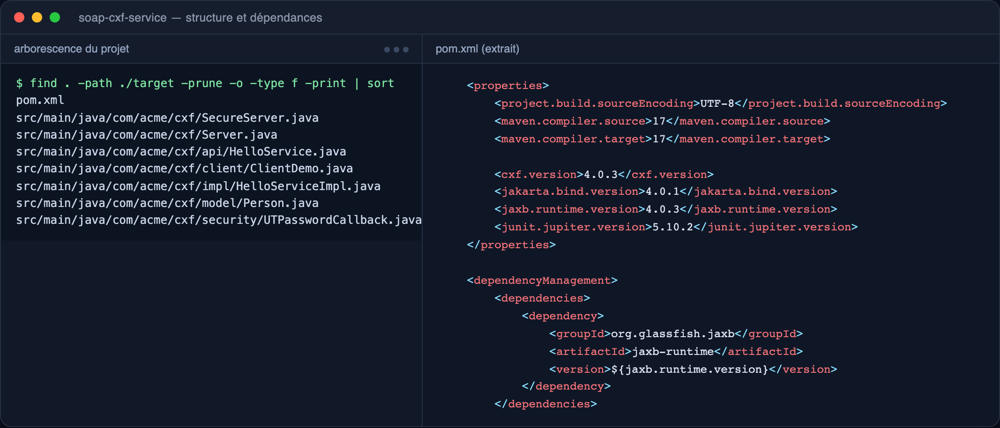
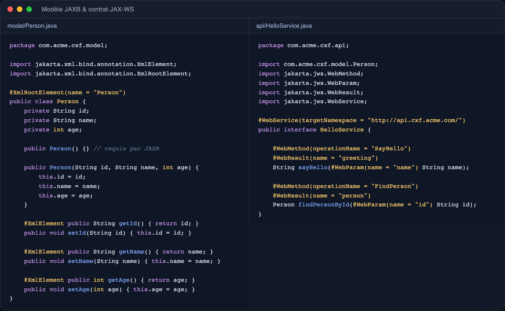
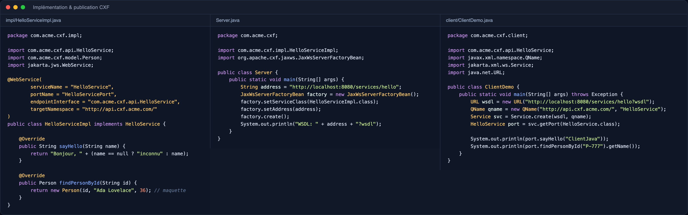
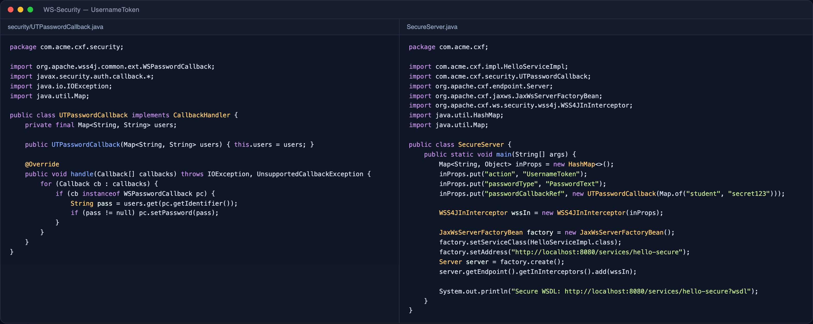
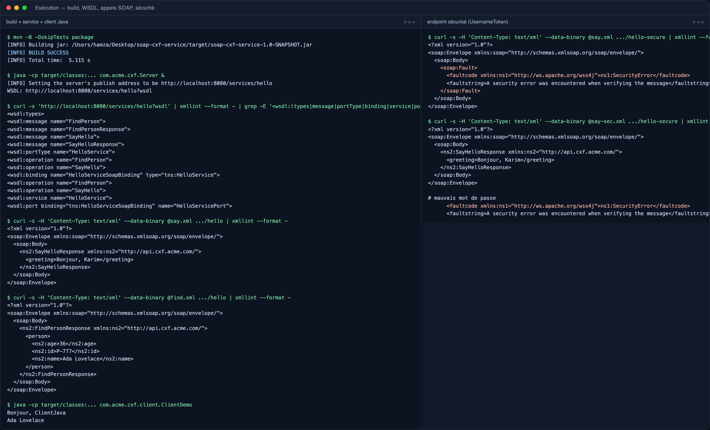

# TP 12 : Service SOAP avec Apache CXF (JAX-WS, JAXB, WSDL, WS-Security)

Projet Maven `soap-cxf-service` exposant un service SOAP `HelloService` (opérations `SayHello` et `FindPerson`) avec Apache CXF sur `http://localhost:8080/services/hello`, un modèle `Person` sérialisé par JAXB, un client Java JAX-WS et un endpoint sécurisé `.../hello-secure` protégé par WS-Security (UsernameToken `student` / `secret123`).

## 1. Structure du projet et dépendances CXF / JAXB / WS-Security

Arborescence du projet Maven et extrait du `pom.xml` : versions `cxf.version=4.0.3`, `jakarta.bind.version=4.0.1`, `jaxb.runtime.version=4.0.3`, dépendances `cxf-rt-frontend-jaxws`, `cxf-rt-transports-http(-jetty)`, `cxf-rt-ws-security`, `jakarta.xml.bind-api`, `jaxb-runtime` et `junit-jupiter`.

## 2. Modèle JAXB et contrat JAX-WS

`Person` annoté `@XmlRootElement` / `@XmlElement` (constructeur vide requis par JAXB) et l'interface `HelloService` annotée `@WebService` avec `@WebMethod`, `@WebParam` et `@WebResult` : c'est ce contrat qui détermine les opérations et les messages du WSDL.

## 3. Implémentation métier, publication CXF et client Java

`HelloServiceImpl` reliée au contrat par `endpointInterface`, publication de l'endpoint avec `JaxWsServerFactoryBean` dans `Server`, et `ClientDemo` qui consomme le service via `Service.create(wsdl, qname)` + `getPort(...)`.

## 4. WS-Security — UsernameToken

`UTPasswordCallback` (CallbackHandler WSS4J) qui fournit le mot de passe attendu pour l'identifiant reçu, et `SecureServer` qui ajoute un `WSS4JInInterceptor` (`action=UsernameToken`, `passwordType=PasswordText`) sur l'endpoint `hello-secure`.

## 5. Exécution : build, WSDL, appels SOAP et sécurité

`mvn -B -DskipTests package` (BUILD SUCCESS), structure du WSDL généré (`types`, `messages`, `portType`, `binding`, `service`, `port`), réponses SOAP de `SayHello` et `FindPerson` (sérialisation JAXB de `Person`), sortie du client Java, puis endpoint sécurisé : `SecurityError` sans token ou avec un mauvais mot de passe, réponse `Bonjour, Karim` avec le token `student` / `secret123`.

